<!-- Place this file as README.md in a repo named exactly like your username (0xmfbk). Put the /assets folder beside it. -->

  

  &nbsp;&nbsp;
  

  
  
  

### About

I'm a cybersecurity practitioner and **Cyber Security Instructor at CyberA4U**. The failures I find most interesting sit between layers: where an app, an identity, a container runtime and the kernel each expect something different from the others. I turn those expectations into tests, and the tests into tools.

### On the bench

<table>
  <tr>
    <td width="50%" valign="top">
      <h4>eBPF Container Escape Framework</h4>
      Researching the seam between container isolation, runtime behavior and the Linux kernel, so low-level questions can be validated in controlled environments.  
      
      
    </td>
    <td width="50%" valign="top">
      <h4>SecureSK-20</h4>
      A second security project in progress. Details live in the project itself.  
      
      
    </td>
  </tr>
</table>

**Learning now:** Rust for security tooling, and a deeper dive into eBPF runtime security.
**Ask me about:** web application penetration testing, infrastructure hardening, Splunk, cybersecurity education.

### Working principles

| | |
|:--|:--|
| **Evidence first** | State the hypothesis, then collect signals that could prove it wrong. |
| **Boundaries before payloads** | Understand the trust model before testing a failure. |
| **Repeatable beats dramatic** | A reproducible case is worth more than an unexplained result. |
| **Automate, but show the work** | Remove repetition without hiding the reasoning. |
| **Authorized environments only** | Test with permission and report limits honestly. |

<b>Open to collaborating on</b>

 

- **Offensive security tooling** with clear scope and outputs another researcher can reason about.
- **DevSecOps and infrastructure** checks that fit real delivery pipelines.
- **AI agents for vulnerability discovery** that stay traceable, measurable and human-reviewed.
- **Kernel and runtime exploration**: Linux internals, eBPF, container isolation.

### Toolkit

  

Also: eBPF, Splunk, JavaScript, TypeScript, PHP, Java, PostgreSQL, MongoDB, Redis, Nginx and more. Depth varies by tool.

### Activity

  
  

  

  &nbsp;&nbsp;
  

Observe carefully. Test responsibly. Document clearly.

