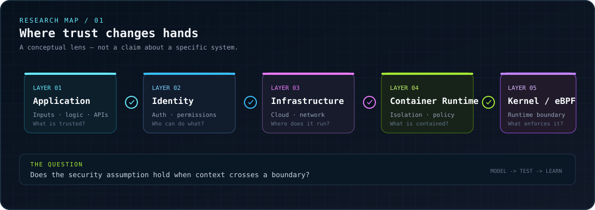

<!--
╔══════════════════════════════════════════════════════════════════════════════╗
║  PROFILE BUILD: 0XMFBK / SECURITY RESEARCH LAB                              ║
║  Design language: midnight terminal · signal cyan · boundary lime           ║
╚══════════════════════════════════════════════════════════════════════════════╝
-->

<p align="center">
  
</p>

<p align="center">
  <a href="https://linkedin.com/in/mustafabanikhalaf"></a>
  <a href="mailto:mustafabanikhalaf772@gmail.com"></a>
  <a href="https://reddit.com/user/0xmfbk"></a>
</p>

<p align="center">
  
</p>

> **I investigate the assumptions between systems.** The interesting failure is often not a single line of code — it is the boundary where an application, identity, runtime, infrastructure, and kernel expect different things from one another.

<p align="center">
  
  
  
  
</p>

---

## `00 / SYSTEM IDENTITY`

```text
┌──(mustafa㉿research-lab)-[~]
└─$ whoami
   Mustafa Bani Khalaf

┌─$ mission
│  Turn security assumptions into testable questions.
│  Build tools that help people see system behavior more clearly.
│  Explore failure modes across application, infrastructure, and kernel boundaries.
└─$ current_mode
   researching · building · teaching · learning Rust
```

I'm a cybersecurity practitioner and **Cyber Security Instructor at CyberA4U**. My interests sit where offensive security meets infrastructure: understanding how systems behave under pressure, turning repeatable investigation into tooling, and connecting security work with automation.

### Quick navigation

| Sector | What you'll find |
|:--|:--|
| [`01 / Research map`](#01--research-map) | The boundaries that keep me curious |
| [`02 / Active builds`](#02--active-builds) | Current projects and research themes |
| [`03 / Collaboration signals`](#03--collaboration-signals) | What I'd like to build with others |
| [`04 / Field toolkit`](#04--field-toolkit) | Selected tools, languages, and the wider ecosystem |
| [`05 / GitHub telemetry`](#05--github-telemetry) | Public activity and repository signals |
| [`06 / Contact channel`](#06--contact-channel) | Where to reach me |

---

## `01 / RESEARCH MAP`

<p align="center">
  
</p>

### The questions behind the work

- **Runtime & container security** — where do isolation assumptions meet real runtime behavior?
- **Kernel-level research** — how do low-level mechanisms shape the security properties above them?
- **Offensive security tooling** — how can investigation become more repeatable, observable, and useful?
- **DevSecOps & infrastructure hardening** — how do we make security part of the pipeline instead of a late-stage surprise?
- **AI-agentic automation** — how can agents help with vulnerability discovery while keeping the workflow measurable and human-reviewable?

My mental model is simple: **map the boundary, state the assumption, test the assumption, document what happened.** A finding is more useful when someone else can understand the conditions that produced it.

---

## `02 / ACTIVE BUILDS`

<table>
  <tr>
    <td width="50%" valign="top">
      <h3>⌁ eBPF Container Escape Framework</h3>
      <p><code>RUNTIME SECURITY / CONTAINER BOUNDARIES</code></p>
      <p>A current build exploring the seam between container isolation, runtime behavior, and the Linux kernel. The goal is to make low-level security questions concrete enough to investigate and validate in controlled environments.</p>
      <p> </p>
    </td>
    <td width="50%" valign="top">
      <h3>⌁ SecureSK-20</h3>
      <p><code>SECURITY PROJECT / ITERATIVE DEVELOPMENT</code></p>
      <p>A second project in my current workbench. I'm keeping this profile-level description intentionally high-level rather than inventing implementation details that should be established by the project itself.</p>
      <p> </p>
    </td>
  </tr>
</table>

### Build principles

| Principle | What it means in practice |
|:--|:--|
| **Evidence over vibes** | Make the hypothesis explicit; gather signals that can support or challenge it. |
| **Boundaries before payloads** | Understand the trust model and execution context before testing a failure mode. |
| **Reproducibility matters** | Prefer a repeatable test case over a dramatic but unexplained result. |
| **Automation with inspection** | Reduce repetitive work without making the reasoning invisible. |
| **Responsible research** | Work in authorized, controlled environments and communicate limitations clearly. |

---

## `03 / COLLABORATION SIGNALS`

I'm especially interested in collaborating with people building at the intersection of:

<details>
  <summary><strong>Signal A — Offensive security tooling</strong></summary>
  <p>Practical tools that improve reconnaissance, validation, analysis, or reporting — with clear scope and outputs that another researcher can reason about.</p>
</details>

<details>
  <summary><strong>Signal B — DevSecOps & infrastructure</strong></summary>
  <p>Security checks that fit into real delivery workflows, infrastructure hardening, observability, and useful feedback loops between development and security.</p>
</details>

<details>
  <summary><strong>Signal C — AI agents for vulnerability discovery</strong></summary>
  <p>Ways to scale investigative workflows with agents while preserving traceability, evaluation, human oversight, and safe testing boundaries.</p>
</details>

<details>
  <summary><strong>Signal D — Kernel and runtime exploration</strong></summary>
  <p>Technical discussions around Linux internals, eBPF runtime security, container isolation, and the gap between a security model and what actually executes.</p>
</details>

**What I'm learning now:** Rust for security tooling, with a deeper dive into eBPF runtime security.

**What you can ask me about:** Web application penetration testing, infrastructure hardening, Splunk, and cybersecurity education.

---

## `04 / FIELD TOOLKIT`

The badges below are a **tool and technology inventory**, not a claim that every item has the same depth of experience. The visible set emphasizes the themes closest to my current work; the broader ecosystem is grouped into expandable sections so the profile stays navigable.

### Current signal set

              

### Languages & low-level building blocks

                    

<details>
  <summary><strong>Web engineering, frameworks & APIs</strong> — expand toolkit</summary>

                                             

</details>

<details>
  <summary><strong>Cloud, systems & infrastructure</strong> — expand toolkit</summary>

                      

</details>

<details>
  <summary><strong>Data platforms & storage</strong> — expand toolkit</summary>

                   

</details>

<details>
  <summary><strong>Delivery, observability & collaboration</strong> — expand toolkit</summary>

                          

</details>

<details>
  <summary><strong>Design, creative tools & wider ecosystem</strong> — expand toolkit</summary>

                
  

</details>

---

## `05 / GITHUB TELEMETRY`

<p align="center">
  
  
</p>

<p align="center">
  
</p>

<p align="center">
  
</p>

<p align="center">
  
</p>

<sub>Telemetry widgets are provided by external community services. Their availability, theme rendering, and reported numbers can vary; GitHub remains the source of truth for repository activity.</sub>

---

## `06 / CONTACT CHANNEL`

<p align="center">
  <strong>Have a hypothesis worth testing, a useful tool to build, or a security problem that needs careful thinking?</strong><br />
  Let's compare notes.
</p>

<p align="center">
  <a href="mailto:mustafabanikhalaf772@gmail.com"></a>
  <a href="https://linkedin.com/in/mustafabanikhalaf"></a>
  <a href="https://reddit.com/user/0xmfbk"></a>
</p>

### Support the work

If you'd like to support future experiments and learning, the original profile included these channels:

<p>
  <a href="https://paypal.me/MUSTAFABANIKHALAF"></a>
  <a href="https://ko-fi.com/0xmfbk"></a>
</p>

<p align="center">
  
</p>

<p align="center">
  <sub>Built with curiosity. Tested with care. Shared with context.</sub><br />
  <sub><code>END OF TRANSMISSION // 0XMFBK</code></sub>
</p>
