<!-- Put this file as README.md in a repo named exactly 0xmfbk, with the /assets folder next to it. -->

  &nbsp;&nbsp;
  



  
  
  
  






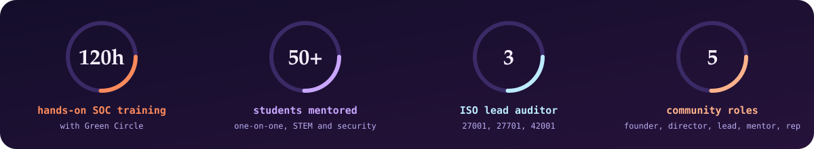




I build something new most weeks, in different corners of security and beyond. These four are a sample; the full list, with write-ups, lives on the [portfolio](https://oxmfbk.netlify.app/projects).

<table>
  <tr>
    <td width="25%" valign="top"><b><a href="https://github.com/0xmfbk/Automato_Builder">Automata Builder</a></b> Interactive web tool to build and simulate DFA, NFA and ε-NFA. JavaScript, p5.js</td>
    <td width="25%" valign="top"><b><a href="https://github.com/0xmfbk/NetRiskScanner-Tool">NetRiskScanner</a></b> GUI scanner on Nmap with 10+ scan types and AI-assisted risk analysis. Python, Nmap, CVE data</td>
    <td width="25%" valign="top"><b><a href="https://github.com/0xmfbk/NeuroVisionAI">NeuroVisionAI</a></b> Desktop app that classifies brain MRI scans into 4 Alzheimer's stages. Python, Tkinter, Roboflow</td>
    <td width="25%" valign="top"><b><a href="https://github.com/0xmfbk/SecureSK-20">SecureSK-20</a></b> Terminal toolkit for password hashing, encryption and file integrity. Python, cryptography</td>
  </tr>
</table>


  
  
  
  
  
  
  
   
  
  
  
  
  
   
  
  
  
  
  
  
  
   
  
  


  
  

  


Open to conversations with people working in security, red teaming and DevSecOps.

  
  
  

  &nbsp;&nbsp;
  

